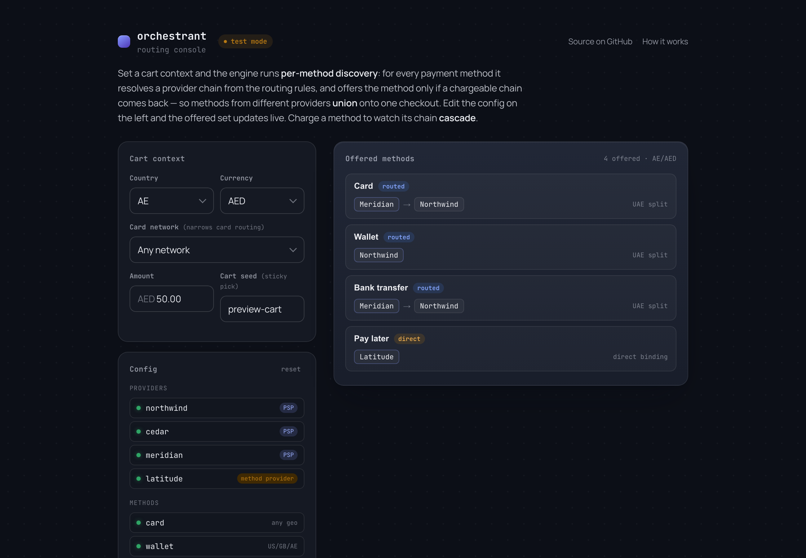

# orchestrant

A framework-agnostic **payment orchestration engine**, wrapped in a thin
**Next.js** app, frontend and backend in one repo. It answers the two questions a
real checkout asks: *which payment methods do we offer this cart, and how does
each one route* — then, when a method is charged, it walks that route, cascading
to a fallback on a soft decline, pausing for 3-D Secure, and stopping cleanly on
a hard decline.



The core engine is **pure TypeScript** with no framework or database dependency.
The interactive console imports it directly; a Next.js HTTP API and Postgres plug
in behind the same interfaces.

## The two hard parts

**1. Discovery is a union, not a lookup.** A cart in a given country/currency is
offered *many* methods, each potentially served by a *different* provider, and
each method's route has to be resolved on its own. The engine runs the same
`resolveProviderChain` for every method and offers it only if a chargeable chain
comes back — so the offered set is a union across providers, and the admin
preview can never drift from what the checkout actually shows (they call the same
function).

**2. The charge is all failure cases.** Once a method is charged, the interesting
outcomes are the bad ones: a charge can soft-decline (retry elsewhere),
hard-decline (stop — don't burn the card), time out (the money may or may not
have moved), or demand a 3-D Secure challenge mid-flight. Each is an explicit
`status`, and only `soft_fail`/`timeout` cascade.

Two invariants hold the charge path together:

- **Idempotent replay.** Every attempt is keyed, so a retried or duplicated
  request never double-charges.
- **3-D Secure without double challenges.** `requires_3ds` pauses the chain; on
  resume the already-cleared provider is suppressed, so the shopper is never
  challenged twice for one payment.

## The model

| Piece | Responsibility |
|---|---|
| **Provider** | A PSP with a `config` (which `countries` / `currencies` / `methods` it covers) and a `kind`: `psp` (routed through rule weights) or `method_provider` (binds its one method directly, outside the weights). |
| **Method** (catalog) | A payment method with its own geo cap (`supportedCountries` / `supportedCurrencies`, `null` = unrestricted) — independent of provider coverage. |
| **Routing rule** | Matches a cart on `country` / `currency` / `cardNetwork` (omitted = wildcard); carries provider `weights`, a `fallbackOrder`, and one `isGlobalFallback` catch-all. |
| **`resolveProviderChain`** | For one (cart, method): geo-cap the method → match the highest-priority rule (else the global fallback) → seed-weighted primary pick → build the capped fallback chain. A `method_provider` binds directly when no PSP is eligible. |
| **`resolveOfferedMethods`** | Runs the above for every method and returns the **union** of offered methods (each with its chain), plus the ones that didn't resolve and why. |
| **`executeChargeChain`** | Walks a resolved chain applying the retry model (below). |

Determinism: the primary is a **seed-weighted** draw keyed on a `cartId`, so the
same cart always routes the same way — a retry never ping-pongs between providers.

## The retry model

```
charge on provider →
  success       → done ✅
  soft_fail     → cascade to next provider ↩
  timeout       → cascade (reconcile later) ↩
  requires_3ds  → pause for challenge (skip on resume) ⏸
  hard_fail     → stop the chain ⛔
```

## Project layout

```
app/
  page.tsx                          the routing console (discovery + charge)
  api/{charge,refund,void,health}/  route handlers (HTTP adapter)
src/
  orchestration/
    discovery/                      resolveProviderChain, resolveOfferedMethods,
                                    the seeded weighted pick, the catalog seed
    adapters/  cascade/  routing/   mock gateway, executeChargeChain, resolveRoute
    persistence/  ports.ts  registry.ts  orchestrate-charge.ts  types.ts
  db/                               Drizzle schema, client, seed
tests/                             discovery + engine + service + API tests
```

## Run it

```bash
pnpm install
pnpm dev            # http://localhost:3000
```

Open the console, set a cart context, and watch the offered-method union update as
you edit the config. Charge a method to drive its chain through a scenario:

| Scenario | Outcome |
|---|---|
| Primary approves | the resolved primary authorizes |
| Primary soft-declines → cascade | primary `soft_fail`, the chain cascades to the fallback |
| 3-D Secure, then approves | primary challenges, authorizes on resume |
| Hard decline → chain stops | primary `hard_fail`, later providers are not tried |

The HTTP API demonstrates the same cascade over its own seeded providers:

```bash
curl -s localhost:3000/api/charge -H 'content-type: application/json' \
  -d '{"idempotencyKey":"t1","amount":5000,"currency":"USD","country":"US","card":{"token":"tok_ok","network":"visa"}}'
```

By default everything runs with a seeded **in-memory** store (zero setup). For
**Postgres**, set `DATABASE_URL`, then `pnpm db:push && pnpm db:seed`.

## Develop

```bash
pnpm test        # vitest — discovery, cascade, routing, service, API
pnpm typecheck   # tsc --noEmit
pnpm build       # next build
```

## Scope

The goal is a complete, correct **engine** — discovery and charge — not a
production gateway. The orchestration logic (per-method discovery, routing,
cascade, 3-DS, idempotency, persistence) is fully built and tested against a mock
provider, so the hard part is done and verifiable without a merchant account or
secrets. The catalog, providers, and rules are an invented, self-contained
reference model, not any real payment system's data.

Deliberately out of scope (they need real provider credentials, not more engine):
a real demo adapter behind the `PSPAdapter` contract, webhook signature
verification, and production hardening (rate limits, structured logging, a real
3-DS iframe).

## License

MIT. See [LICENSE](./LICENSE).
